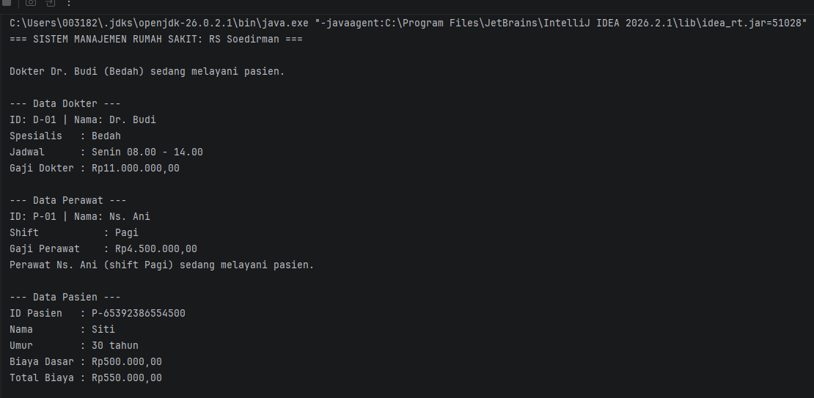
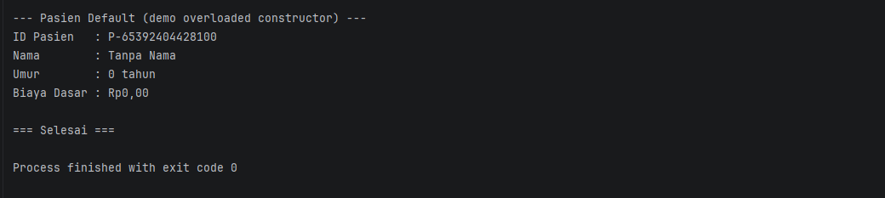

# Sistem Manajemen Rumah Sakit

Tugas Responsi Praktikum Pemrograman Berorientasi Objek
Jurusan Informatika, Fakultas Teknik, Universitas Jenderal Soedirman

## Identitas Mahasiswa
- Nama        : Anggit Latifah Kinanti 
- NIM         : H1D025127 
- Shift KRS   : D 
- Shift Baru  : G 
- Tema        : Rumah Sakit (digit terakhir NIM 7)

## Deskripsi Singkat

Sistem ini memodelkan manajemen sederhana sebuah rumah sakit. Terdapat entitas
tenaga medis (dokter dan perawat) serta pasien. Sistem menghitung gaji tenaga
medis dan biaya pasien, menampilkan informasi, serta mendemonstrasikan seluruh
konsep OOP yang disyaratkan pada lembar tugas.

## Struktur Proyek
1. ├── Dokter.java # Subclass + implements Pelayanan, Jadwal 
2. ├── Jadwal.java # Interface 
3. ├── Main.java # Class utama (berisi pengujian)
4. ├── Pasien.java # Class entitas pasien 
5. ├── Pelayanan.java # Interface 
6. ├── Perawat.java # Subclass + implements Pelayanan 
7. ├── README.md 
8. ├── Rupiah.java # Helper format mata uang 
9. ├── TenagaMedis.java # Abstract class (superclass)
10. └── .gitignore


## Pemetaan Requirement Teknis

| No | Konsep | Lokasi Implementasi |
|----|--------|---------------------|
| 1 | State & Behavior | `Pasien.tampilkanInfo()` (void) & `Pasien.hitungBiayaTotal()` (return) |
| 2 | Immutability | `TenagaMedis.NAMA_RS` (`public static final`), `idTenagaMedis` & `idPasien` (`private final`) |
| 3 | Enkapsulasi & Overloading | Atribut `private` + getter/setter + `this`; 2 konstruktor di `TenagaMedis` & `Pasien` |
| 4 | Inheritance | `TenagaMedis` → `Dokter`, `Perawat`; `Main` terpisah |
| 5 | Super Chaining | `super(...)` di konstruktor subclass; `super.tampilkanInfo()` |
| 6 | Method Overriding | `@Override` pada `tampilkanInfo()` & `hitungGaji()` |
| 7 | Abstract Class | `TenagaMedis` abstract + `abstract double hitungGaji()` |
| 8 | Percabangan di Abstract Method | `Dokter.hitungGaji()` & `Perawat.hitungGaji()` memakai if/else yang mengubah state `gaji` |
| 9 | Polimorfisme Interface | `Pelayanan p = new Dokter(...)` di `Main` |
| 10 | Multiple Interface | `Dokter implements Pelayanan, Jadwal` |

## Petunjuk Compile dan Run (Terminal)

Pastikan **JDK sudah terpasang** (`javac -version` menampilkan versi).

1. Buka terminal di direktori proyek.
2. Compile seluruh file Java:
   ```bash
   javac *.java

## Output




C:\Users\003182\.jdks\openjdk-26.0.2.1\bin\java.exe "-javaagent:C:\Program Files\JetBrains\IntelliJ IDEA 2026.2.1\lib\idea_rt.jar=51028" -Dfile.encoding=UTF-8 -Dsun.stdout.encoding=UTF-8 -Dsun.stderr.encoding=UTF-8 -classpath C:\Users\003182\PBO\Responsi_RumahSakit\out\production\Responsi_RumahSakit Main
=== SISTEM MANAJEMEN RUMAH SAKIT: RS Soedirman ===

Dokter Dr. Budi (Bedah) sedang melayani pasien.

--- Data Dokter ---
ID: D-01 | Nama: Dr. Budi
Spesialis   : Bedah
Jadwal      : Senin 08.00 - 14.00
Gaji Dokter : Rp11.000.000,00

--- Data Perawat ---
ID: P-01 | Nama: Ns. Ani
Shift           : Pagi
Gaji Perawat    : Rp4.500.000,00
Perawat Ns. Ani (shift Pagi) sedang melayani pasien.

--- Data Pasien ---
ID Pasien   : P-65392386554500
Nama        : Siti
Umur        : 30 tahun
Biaya Dasar : Rp500.000,00
Total Biaya : Rp550.000,00

--- Pasien Default (demo overloaded constructor) ---
ID Pasien   : P-65392404428100
Nama        : Tanpa Nama
Umur        : 0 tahun
Biaya Dasar : Rp0,00

=== Selesai ===

Process finished with exit code 0
